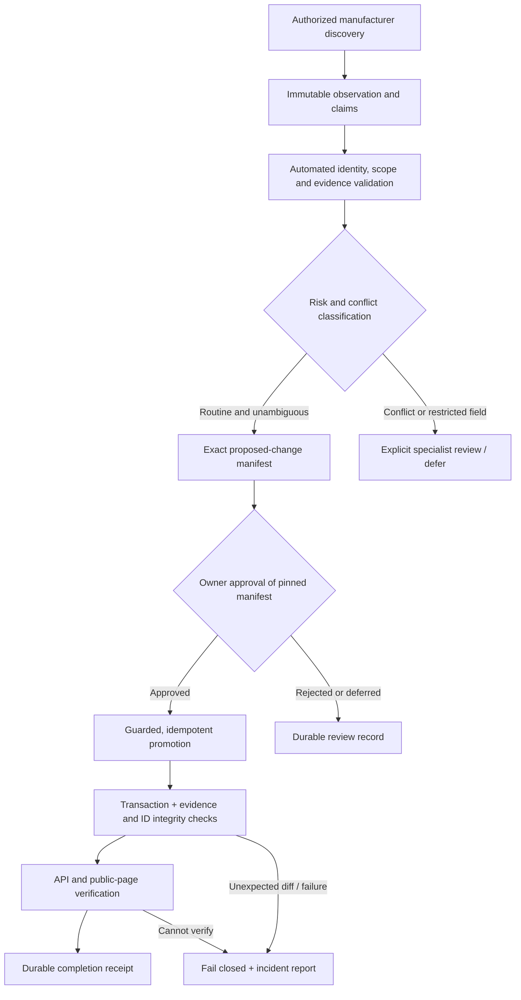

# HumanoidOnline — Automated Commercial Intelligence Pipeline

**Status:** PROPOSED — implementation specification; not production-authorized. The owner architectural decisions below are approved principles; no implementation is approved or complete.  
**Date:** 2026-10-19  
**Owner:** HumanoidOnline Product Owner  
**Scope:** Catalogue importer safety, governed claim promotion, automated post-approval publication and verification  
**Related work:** PR #169 (Batch 1), #170 (Batch 2), #171 (merged planning documents), #172 (K1 correction, draft), #173 (Phase 0 integrity report, draft), #174 (stable-ID design and acceptance tests, draft)

> **Core objective:** Manufacturer data is **discovered automatically → validated automatically → approved once → published automatically → verified automatically**.
>
> **Governing principle:** Verified knowledge is a durable asset, not disposable import data.

## Owner Architectural Decisions — 2026-10-19

Recorded by the product owner on 2026-10-19. They are binding architectural principles for the
work this document describes. They do **not** approve any implementation, migration, import,
deployment or credential; each of those still needs its own approval.

- **D1 — Non-destructive reconciliation.** Missing JSON fields or child rows do not authorize
  deletion. Routine imports preserve existing database records. Retirement, replacement,
  retraction and deletion require explicit authorized changes, with ownership and evidence checks.
- **D2 — Stable deployment identity.** New deployment records use an explicit durable
  `deployment_key`. Existing deployments must not be reassigned identities through unsupported
  inference. Any necessary schema migration requires separate approval.
- **D3 — Evidence versioning.** Materially changed evidence is a new traceable version. Original
  evidence and audit history are preserved.
- **D4 — Rehearsals.** An isolated Neon rehearsal branch or a local database restored from a
  production read-only dump is acceptable, provided equivalent integrity, isolation and recovery
  requirements are met.
- **D5 — Production automation credentials.** Granting production write access to GitHub Actions
  is **not authorized**. Least-privilege authentication, environment protection, approval binding
  and security controls must be defined in a separate proposal before permission is requested.

**Relation to PR #174.** These decisions supersede any conflicting proposal in PR #174
(`docs/discovery/STABLE_ID_RECONCILIATION_DESIGN_2026-10-19.md`). In particular:
- #174 §2 and §4 delete a natural key that is no longer listed in the JSON. Under D1 this is not
  permitted for routine imports; removal must be an explicit, authorized change.
- #174 D2 (deployment natural key) is decided by D2 above: an explicit `deployment_key`, not an
  inferred key and not delete-and-reinsert.
- #174 D3 (evidence key) is decided by D3 above: a materially changed excerpt is a new version.

PR #174 is not modified by this document. Reconciling it with these decisions is separate work.

## Relation to the HO-DATA Fast Lane — 2026-10-22

The owner-approved HO-DATA Fast Lane ([`08_DEVELOPMENT_ROADMAP.md`](../08_DEVELOPMENT_ROADMAP.md)
§1.2) is the operating cadence for this document's single approval: standing research
authorization ([`HO-DATA-SR-01`](../HO_DATA_SR_01_STANDING_RESEARCH_ORDER.md)) → authorized
research batches → **one owner approval per validated production batch**. It adds no pipeline,
scheduler, source registry or approval system; its steps FL-1 to FL-4 reuse Workstream B
(§5) and the ROUTINE / REVIEW REQUIRED / RESTRICTED classes of §5 B2 unchanged.

- D1–D5 are unchanged. In particular **D5 still withholds production write credentials from
  GitHub Actions**; the Fast Lane does not request or imply them.
- The promotion executor is **not activated** (see
  [`CATALOGUE_PROMOTION_AUTOMATION_DESIGN_2026-10-19.md`](CATALOGUE_PROMOTION_AUTOMATION_DESIGN_2026-10-19.md)
  and the activation gates in
  [`PROMOTION_EXECUTOR_SECURITY_PROPOSAL_2026-10-19.md`](PROMOTION_EXECUTOR_SECURITY_PROPOSAL_2026-10-19.md)).
  Until D5 is decided, post-approval execution is an operator-run step, within the named
  actions of the owner's approval.
- Research under HO-DATA-SR-01 keeps provenance `AGENT_ASSISTED_RESEARCH`; owner approval of a
  batch is not human verification.

## 1. Why this development is needed

HumanoidOnline has a governed manufacturer-discovery and catalogue-enrichment system, but turning a verified new specification into an update to an existing published robot still entails many separate manual operations: checking claims, modifying catalogue JSON, preparing an expected-change manifest, merging code, creating a Neon safety branch, importing selected robots, running semantic preflight, and checking the live website.

The existing `db/import_catalogue.py` function `_reset_robot_children()` deletes and recreates selected robots' child records on every import, including offers, availability, variants, images, use-case associations, importer-managed specifications and related evidence. The business content may be restored unchanged, but the database IDs are replaced; this can break historical references and makes a small field update appear to touch many unrelated records. Some records have stricter ownership protection than others. A variant delete may also cascade to variant-scoped rows.

The first two controlled enrichment batches demonstrated safe **outcomes** through extensive checks, not a safe **primitive** for routine incremental updates. The October 19 reconciliation identified **25 of 45** catalogue write-audit rows with dangling historical target IDs. The Phase 0 report (#173, draft) classifies all 25 as relinkable, but that does not make destructive re-import behavior acceptable for a growing production system.

**Decision:** Correct the importer and its data-governance boundaries **before** activating unattended production promotion at scale. Keep established evidence, claim approval, publication and safety mechanisms; do not rebuild the discovery platform.

## 2. Target operating model

The owner approves a **specific factual change set** once. Once the automation itself has been separately authorized for production use, successful approval of a pinned manifest triggers the technical steps without further routine manual intervention. Any change to the approved manifest or materially conflicting production baseline invalidates that approval.

**Do not confuse automatic execution with automatic factual approval.** New facts, corrections and commercial claims continue to have evidence and authorization requirements. The existing robot publication state is preserved unless expressly changed through its separate editorial workflow.

## 3. Non-negotiable data invariants

1. **No gratuitous writes:** Importing unchanged data must make zero business or timestamp changes and must preserve all stable record IDs.
2. **Durable evidence:** Unchanged observations, source excerpts, claim provenance, verification status, confidence, media rights and audit references retain their identity and history.
3. **Explicit ownership:** The importer changes only records it owns or changes explicitly authorized by the approved manifest. Unmarked or independently authored records are never silently adopted or overwritten.
4. **Patch rather than implicit replacement:** A missing field in an incremental proposal means *no change*, not `NULL`, deletion, or retraction. Snapshot reconciliation, if retained for maintenance, must be explicitly selected and governed.
5. **No silent destruction:** Deletions and retractions are explicit, reviewed operations, with a named actor, reason, affected logical keys and a recoverable audit trail. Prefer retirement/state transitions for historical commercial offers.
6. **No cascade surprise:** Variant removal cannot delete independently managed specifications or offers without an explicit authorized dependency plan.
7. **Three distinct commercial dimensions:** Commercial maturity, seller availability and deployment evidence remain separate. A new specification cannot imply saleability or deployment readiness.
8. **Publication is editorial:** Routine fact updates do not modify `is_published`, prices, availability, rights/licensing or other protected state.
9. **Source scope matters:** The exact robot, generation, edition, operating conditions and units must be validated; a manufacturer family fact is not automatically an edition fact.
10. **Fail closed:** An unexpected semantic change, ambiguous identity, stale evidence, missing safety point or uncertain write ownership prevents automatic production promotion.

## 4. Workstream A — Safe, stable catalogue importer (blocking prerequisite)

**Goal:** Replace delete-and-reinsert with deterministic, transactionally safe, **stable-ID** incremental updates that preserve independently verified knowledge.

### A1. Inventory and design boundary

Inspect `db/import_catalogue.py`, `db/schema.sql`, migration history, `db/import_preflight.py`, `apps/api/app/services/discovery/materialize.py`, and existing acceptance tests. Review PRs #173 and #174 rather than duplicating their code. Establish an inventory of tables, ownership markers, unique constraints, natural/logical keys, soft references, foreign-key cascades, and records with known audit lineage.

Separate two operations:

- **Incremental promotion (`PATCH`)**: Only manifest-authorized fields and additions may change. Omission never deletes or nulls anything. This is the default for future automated enrichment.
- **Explicit catalogue synchronization (`RECONCILE`)**: Permitted only within a documented ownership boundary (see D1). Deletes or retirements are separate, manifest-listed changes that require review; never infer destructive authority merely from missing JSON.

### A2. Stable-ID update algorithm

For each selected robot, within a single database transaction:

1. Validate the approved manifest, actor, robot/edition identity, original source claims, and exact expected changes **before** opening the write path.
2. Load the current rows and their provenance. Resolve canonical logical keys (including nullable variant, provider and region attributes as necessary).
3. Refuse ambiguous or duplicate logical keys; never guess which row should be updated.
4. For an unchanged row: **no SQL UPDATE**, no timestamp change, and no replacement ID.
5. For an authorized correction to a known logical row: update **only changed, authorized columns in place**, keeping its ID; retain the original evidence and append new provenance where appropriate.
6. For an authorized new row: insert once and attach traceable claim/evidence references.
7. For omitted records: leave untouched. Handle explicit retirement, retraction and deletion separately.
8. Validate protected fields and downstream relationships before commit. Produce machine-readable before/after diff and rollback on any violation.

### A3. Logical identity and open design decisions

Use the PR #174 design as a starting point, but verify actual schema and production data before codifying keys.

| Table | Proposed identity rule | Caution / decision |
|---|---|---|
| `robot_variant` | Robot + stable variant slug | Protect dependent rows before variant changes |
| `specification` | Robot + nullable variant + definition | Preserve unmanaged rows; `edition_scope` is provenance, not part of existing unique index |
| `pricing_offer` | Stable offer identity; business fields for matching only where proven | Price/currency/status can change; distinguish current and historical offers and NULL semantics; migration for unique key only after review |
| `availability_offer` | Stable offer identity; current/historical state | `is_current` transitions must not silently create or collapse history |
| `deployment` | Explicit durable `deployment_key` (D2) | Do not rely on nullable customer name or mutable start date; existing rows are not re-keyed by inference |
| `robot_image` | Robot + durable image identity | Preserve licensing, human approvals, attribution and verification metadata |
| `robot_capability`, `use_case_fit` | Existing relationship keys | Updating a note must not recreate relationship identity or clear other fields |
| `evidence_source` | Durable source-observation identity | A materially changed excerpt is a new evidence version, not a destructive rewrite (D3) |

**Migrations:** If stable business identities, uniqueness indexes or provenance versions require schema changes, prepare separate migration PRs with production-data collision scans and rollback plans. No migration is authorized by this document.

### A4. Protect existing audit and provenance history

- Reuse the Phase 0 integrity report from PR #173 as a read-only diagnostic after code review.
- Prevent **new** dangling `catalogue_write_audit.target_row_id` references during imports.
- Preserve all original audit records. Historical repairs, if approved later, must be append-only and relink only where target identity is uniquely demonstrable by claim, logical target, content hash and chronology; ambiguous rows remain unresolved.
- Keep original evidence timestamps and human verification state intact. A fresh machine observation does not constitute human verification.

### A5. Required importer acceptance criteria

A scratch database and a production-equivalent rehearsal database (an isolated Neon rehearsal branch or a local restore of a read-only production dump; see D4) must demonstrate:

- Unchanged single-robot and full-catalogue imports make **zero semantic changes**, **zero ID changes**, and **zero unexpected timestamp changes**.
- Changing one manufacturer specification changes precisely that specification and any explicitly approved, derived buyer-facing display data.
- No unchanged price, availability, image, evidence, variant, deployment or use-case row changes ID or content.
- Repeating the same approved import has no effects.
- New facts insert exactly once.
- A missing value in a patch does not delete or null an existing fact.
- Attempted deletion/replacement of protected or unowned data is rejected.
- Duplicate/ambiguous keys and dangerous variant cascades fail closed.
- Publication state, commercial status and seller-offer state do not change unless expressly authorized.
- No new dangling audit target or orphan evidence row results.
- Tests map **each logical record to its ID**, not only sets of UUIDs.

**Deliverable PR A:** Importer implementation, safety checks, ownership/update semantics, regression tests and documentation. **Not** a production rollout; owner must approve deployment separately.

## 5. Workstream B — Governed automatic promotion (after A passes)

**Goal:** Connect existing authorized discovery and accepted claims to a bounded, reproducible and auditable promotion workflow; do not rewrite source crawling, ROS/robotics systems, or discovery governance.

### B1. Proposal construction

Generate one deterministic, reviewable **Promotion Manifest** containing:

- Manifest schema version and immutable digest.
- Canonical robot slug, exact generation, model and edition/variant.
- Claim IDs, evidence locators, official source URLs, observation hashes/dates and scope.
- Current field value and proposed value, including units, precision and operating/test conditions.
- Evidence freshness/confidence and any contrary manufacturer or reseller observations.
- Exact allowed logical rows/columns to change; protected-field and deletion impact summary.
- Expected semantic diff, integrity invariants and baseline/revision guard.
- Source commit SHA and implementation/deployment references where relevant.

Human-readable review must be generated from the same immutable data; avoid separate documents that can drift from the approved manifest.

### B2. Classification and validation

- **ROUTINE:** New, unambiguous manufacturer-supported *technical* facts for an existing, correctly identified robot/edition, with no conflicting values or protected-field impact.
- **REVIEW REQUIRED:** Manufacturer-versus-reseller conflicts, change to existing values, unclear edition/generation, measurement-condition ambiguity or uncertain schema vocabulary.
- **RESTRICTED:** Price, commercial maturity, availability, publication state, image rights, evidence retraction, destructive deletion, and new robot publication.

Only ROUTINE proposals enter the initial fast lane. A reviewer can approve higher-risk changes, but they must use a distinct explicitly scoped workflow with their own gates. Never auto-resolve conflicts by preferring whichever source is newest.

### B3. One explicit owner approval

The owner reviews a **pinned manifest** stating what will change, what will not change, supporting evidence and public display implications. Approval binds to exact manifest digest and commit and is recorded durably with approver, timestamp and decision.

After this **single factual approval**, the system may complete ordinary technical publication automatically, provided its deployment authority has been separately activated by the owner. Rejected/deferred proposals remain durable and cannot be silently resubmitted as newly approved facts.

### B4. Guarded execution in cloud infrastructure

The executor is not decided. The workflow should not depend on the owner's Ubuntu or Windows machine, but production write access for GitHub Actions is **not authorized** (D5); the executor, its authentication and its controls need a separate proposal and approval first.

Sequence:

1. Verify exact approved manifest, commit, approval provenance and least-privilege credentials.
2. Acquire per-robot/promotion lock and confirm no conflicting import is running.
3. Check current production fingerprint/revision; detect unexpected drift.
4. Create and verify a recoverable Neon safety point or branch before the first write.
5. Rehearse against a production-equivalent copy using the expected-change manifest.
6. Gate on no unexpected semantic differences, protected-field changes, orphan evidence, new dangling audits or ID churn.
7. Apply the exact authorized patch transactionally; use deterministic idempotency keys.
8. Verify semantic diff and referential/provenance invariants **after commit**.
9. Wait for required API/site deployment and validate public robot-detail and compare behavior.
10. Record a durable completion receipt and notify the owner with the outcome.

Failure handling: fail closed before commit; rollback failed transactions. After commit, an unsuccessful external/public check creates an actionable incident and blocks further automatic promotion. Do not blindly restore a database over concurrent legitimate writes.

### B5. Verify what visitors and agents actually see

For every published robot touched:

- Detail route is reachable and displays the right values, units and caveats.
- Measurement conditions accompany runtime/speed when needed.
- Compare does not mark incomparable measurements as winners.
- Source attribution, citation facts and supported structured metadata are consistent and non-misleading.
- Publication status and commercial availability remain unchanged unless authorized.
- API and public pages reflect the new committed version (not a stale deployment/cache).

A successful SQL transaction alone is **not** a successful publication.

**Deliverable PR B:** Manifest schema/validator, exact-scope owner-approval boundary, guarded GitHub workflow, safe importer invocation, verification and receipts. Activate only after owner approval and PR A rollout.

## 6. Test plan and measurable success

| Scenario | Required result |
|---|---|
| Identical import twice | Second run produces zero writes, zero churn |
| One new technical manufacturer fact | Exactly one authorized logical fact added; unrelated rows unchanged |
| One corrected fact | Only approved fields updated in place; evidence preserved |
| Same manifest executed twice | No duplicate writes; second run reports idempotent completion |
| Manifest changed after approval | Refuse and request new approval |
| Concurrent promotions on same robot | Serialize or refuse safely |
| Stale or conflicting manufacturer evidence | Hold for review |
| Incomplete proposal omits existing data | Existing production data preserved |
| Variant cascade threatens unowned row | Refuse without any committed changes |
| Unauthorized price/availability/publication change | Refuse |
| Post-commit API or public display mismatch | Fail verification, retain incident/audit record |
| Missing safety branch or bad deployment health | No production write |

**Pilot:** Use one real, unpublished-to-production *fact* for an already published robot only if it is unambiguous and evidence-backed; otherwise use a clearly marked synthetic claim on a local restored database. Do not invent a fact to satisfy the pilot.

**Success measures:**

- **1** owner factual-approval action per manifest.
- **0** routine manual production commands after approval.
- **0** unauthorized semantic changes.
- **0** gratuitous row-ID or timestamp churn.
- **0** new dangling audit targets or orphan evidence rows.
- Verifiable completion receipt for every approved promotion.

## 7. PR, release and rollback structure

1. **Review PR #173:** Phase 0 read-only integrity reporting; verify classifications and tests. Keep report non-gating initially.
2. **Review PR #174:** Stable-ID design and acceptance tests; use as basis, not as evidence importer is already fixed.
3. **PR A — Safe importer:** implement stable-ID and protected patch semantics, including regression tests. No production activation within review.
4. **If needed, separate schema migration PRs:** natural-key/index/deployment/evidence-version changes, separately owner-approved.
5. **Importer rollout:** full local rehearsal on production restore; CI green; explicit owner approval; Neon safety point; scoped pilot; post-import integrity checks; then broader use.
6. **PR B — Promotion automation:** implement owner-approved, exact-manifest post-approval flow in the cloud. Test against a rehearsal environment with failure injection.
7. **Activation approval:** explicitly enable automated production promotion only after end-to-end pilot passes. Existing manual governed path remains available as fallback until proven stable.

Keep protected history and safety branches until the agreed retention policy authorizes cleanup. A recovery procedure must be tested and documented before automatic production activation.

## 8. Definition of done and owner handoff

Claude Code should return:

1. Root-cause analysis and the exact code/data ownership contract.
2. Draft PR links and pinned commit SHAs.
3. Test commands and results, including unexpected skips/xfails.
4. Schema migration needs with rationale and data-collision assessment.
5. Before/after semantic fingerprints, key-to-ID mappings and audit-integrity reports.
6. End-to-end simulated approval-to-public-verification pilot results.
7. Security/permissions review and recovery procedure.
8. Exact activation gates, unresolved owner decisions and operator runbook.

### Explicitly out of scope

- No new robot identity or commercial-status approval through the routine fast lane.
- No automatic price, availability, publication or media-rights changes.
- No production writes, merges, schema migrations or workflow activation solely because this document exists.
- No wholesale replacement of the discovery, evidence or existing deployment systems.
- No relaxation of human editorial authority over verified claims or published visibility.

---

**Implementation request:** Use this document as the controlled development specification. Design and implement in draft PRs, demonstrate the invariants on a realistic restored database, then request owner authorization at the stated rollout gates. The end state is a production catalogue that accumulates verified manufacturer knowledge without periodically rebuilding, losing or silently rewriting what it already knows.
